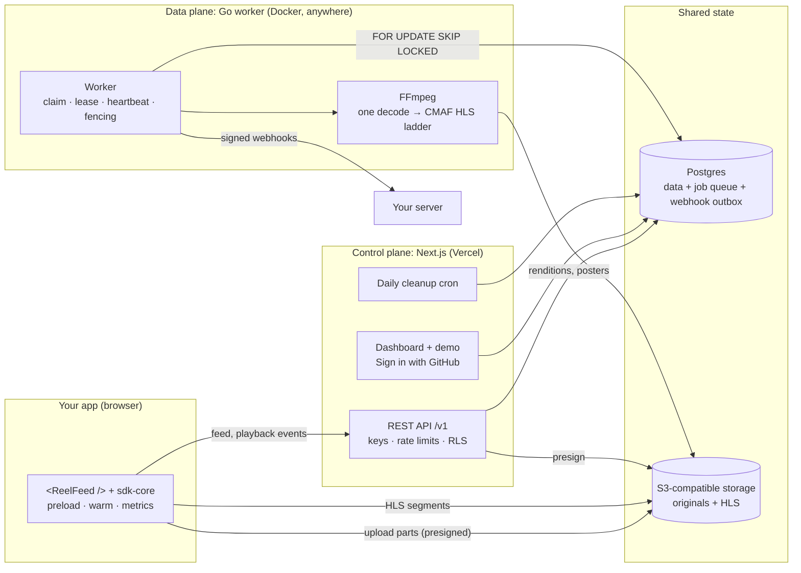

# Reelplane

**An open-source Reels SDK and video backend: a swipeable `<ReelFeed />` for your app, plus the
upload, transcoding and feed pipeline behind it, built to run free.**

**Live demo:** _link coming soon_ ·  _(placeholder)_

Reelplane gives you three things:
- **A feed component** that plays the next video the moment you swipe.
- **Resumable uploads straight to storage.**
- **A Go/FFmpeg worker** that turns uploads into an adaptive HLS ladder.

A Postgres job queue ties them together and survives workers being killed mid-encode.

## Measured, not estimated

Every number comes from [docs/BENCHMARKS.md](docs/BENCHMARKS.md), which says how each was
measured and how to reproduce it.

| What                                 | Result                                                                                                            |
| ------------------------------------ | ----------------------------------------------------------------------------------------------------------------- |
| **Swipe-to-play** (Chrome, Fast 4G)  | **35 ms** p50 with preloading vs 1,081 ms without (**31× faster**); p95 75 vs 1,381 ms                            |
| Swipe-to-play on a real iPhone       | 69 ms p50 with preloading (local Wi-Fi, laptop as server)                                                         |
| **Chaos test**                       | 100 jobs, **64 workers killed** mid-job: **100/100 completed exactly once**, 0 duplicates, 0 orphaned files       |
| **Lighthouse** (demo, mobile)        | **96** performance (was 70), 100 accessibility / best practices / SEO; LCP 2.5 s                                  |
| **Load test** (k6, one Node process) | 100 feed + 10 upload-session req/s: feed **p95 48 ms**, p99 150 ms, 0 errors; ~120–140 req/s per process          |
| **Transcode speed**                  | **1.38× realtime** on a 2-vCPU worker (11 clips; 4.3× faster after capping FFmpeg's threads), 2.91× on 24 threads |

## Quick start

Needs Node 22+, pnpm, Docker, Go 1.27 and FFmpeg. No accounts.

```bash
pnpm install
pnpm infra:up && pnpm infra:init    # Postgres + S3-compatible storage in Docker, migrations
pnpm showcase:clips                 # cut the openly licensed demo clips
pnpm phone                          # worker + demo videos + web app, prints the URLs
# open http://localhost:3000 (or the printed URL on your phone)
```

## Architecture



- **The control plane** is the always-on, cheap part: the API, the dashboard and the demo, on
  Vercel's free plan.
- **The data plane** is the heavy part: FFmpeg in one Docker image that runs on a laptop, a VM
  or any container host. The two only meet in Postgres and storage. So the demo keeps working
  with every worker off: its videos are already transcoded and served straight from storage.

### How the queue survives crashes

Postgres is the queue; there's no Kafka or SQS.
- **Claiming:** workers take jobs with `FOR UPDATE SKIP LOCKED`, under a lease they renew with
  heartbeats.
- **Fencing:** a worker whose lease expired can't publish, because every write checks the lease
  owner.
- **No half-published videos:** each attempt writes to its own storage prefix, and publishing
  is one transaction that points the video at it.
- **No leaked files:** an abandoned attempt's files are recorded as garbage in the same
  transaction that abandons it, and swept later.
- **Retries:** failures retry with exponential backoff and jitter, then dead-letter with the
  error kept.

The chaos test above kills workers at random while 100 jobs run, and checks the result.
Details: [docs/ARCHITECTURE.md](docs/ARCHITECTURE.md).

### The rendition ladder

- **Rungs:** 240p / 480p / 720p / 1080p by the short side, at 300 / 1,000 / 2,500 /
  4,500 kbps, ×1.5 above 30 fps. Only rungs at or below the source's size are made, plus a
  native-resolution rung when the source is more than 20% above the highest one.
- **Frame rate:** kept as it was recorded (24, 25, 30 or 60).
- **HDR:** HLG and PQ phone footage is tone-mapped to SDR BT.709.
- **Encoding:** H.264 + AAC in 2-second CMAF segments, with a keyframe at every segment
  boundary. One decode feeds every rung.
- **Quality:** checked with VMAF (phone model). See
  [BENCHMARKS.md → Ladder quality](docs/BENCHMARKS.md#ladder-quality).

### Preloading strategy

The feed keeps four `<video>` elements and recycles them as you swipe: the current video, the
next two, and the previous one.
- **Preloading:** the next videos load about one segment (~4 s).
- **Warming:** the very next one plays a single muted frame every 4 s, so its decoder is ready
  before you swipe. That's what takes swipe-to-play from ~150 ms to 35 ms.
- **Starting quality:** chosen from measured bandwidth; 720p on a fast network.
- **Data saving:** warming switches off with Data Saver, on slow networks and on a low battery.

## Use it in your app

```tsx
import { ReelFeed } from "@reelplane/sdk-react";

export function Reels() {
  return (
    <div style={{ height: "100dvh" }}>
      <ReelFeed publishableKey="rp_pk_…" feed="trending" />
    </div>
  );
}
```

The `/developers` page of the demo has copy-paste code for uploads and webhooks. The REST API
is described in [`docs/openapi.json`](docs/openapi.json) (OpenAPI 3.1, also served at
`/openapi.json`), with a readable reference at `/developers/api`. Both are generated from the
routes, and a test fails if they drift from the code.

## Dashboard and webhooks

Sign in with GitHub (through Supabase Auth), or with an email link. Per project:
- **Videos:** browser upload, preview, and a live processing timeline from the audit trail.
- **Jobs:** state, attempts, progress and errors.
- **Analytics:** time to first frame p50/p95, rebuffers, completion.
- **API keys:** create, rotate with a grace period, revoke.
- **Webhooks:** endpoints, a test event, and a delivery log with redelivery.

`video.ready`, `video.failed` and `video.deleted` are queued by the database in the same
transaction as the status change. The worker sends them signed (HMAC with a timestamp) and
retries failures. Verify them with `verifyWebhook()` from `@reelplane/sdk-core`.

## Self-hosting

Everything is a config change; no code changes.
- **Postgres:** any (tested on 18; Supabase works).
- **Storage:** any S3-compatible service (RustFS locally; Supabase Storage, Backblaze B2,
  Cloudflare R2, AWS S3).
- **Worker:** any Docker host.

The free, no-card deployment is written up step by step in
[docs/LAUNCH-CHECKLIST.md](docs/LAUNCH-CHECKLIST.md), and the choices behind it (Supabase
Storage, the worker on a laptop) in [docs/DEPLOY.md](docs/DEPLOY.md). Behind your own proxy,
set `TRUSTED_PROXY=proxy` so per-client rate limits count real addresses.

## Development

```bash
pnpm check                       # lint + typecheck + all tests (needs infra:up)
pnpm worker:dev                  # the worker natively (Go + FFmpeg on PATH)
pnpm worker:up                   # or in Docker
pnpm worker:chaos                # kill workers at random while jobs run; checks exactly-once
pnpm --filter @reelplane/web dev # http://localhost:3000; REELPLANE_TEST_AUTH=1 simulates GitHub
pnpm --filter @reelplane/web e2e # Playwright against a running app
pnpm loadtest                    # k6: feed + upload sessions (K6=<path to k6>)
pnpm bench:transcode             # transcode the showcase clips, report speed per job
pnpm --filter @reelplane/web openapi # regenerate docs/openapi.json after an API change
```

**On a phone:** `pnpm phone` serves the app on your Wi-Fi and prints the URL. `?debug=1`
shows live playback stats; `/bench?preload=1` and `?preload=0` measure swipe-to-play.

| Path                 | What                                                |
| -------------------- | --------------------------------------------------- |
| `apps/web`           | Next.js: API, dashboard, demo                       |
| `packages/sdk-core`  | framework-free player, preloading, uploads, metrics |
| `packages/sdk-react` | `<ReelFeed />`                                      |
| `packages/db`        | schema, migrations, RLS, queries                    |
| `packages/storage`   | one S3-compatible storage interface                 |
| `services/worker`    | Go transcoding worker                               |
| `docs/`              | architecture, benchmarks, deploy, launch checklist  |

## License

MIT
