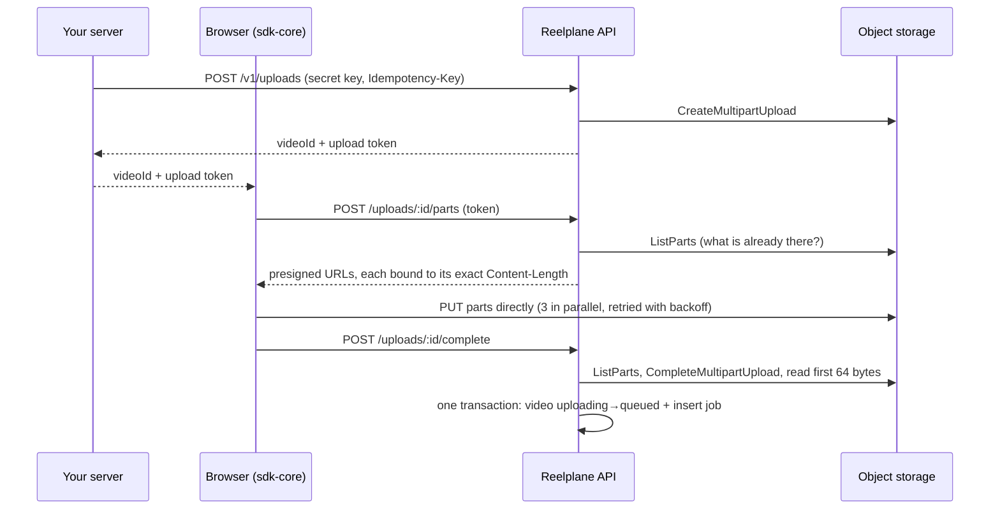

# Architecture and decisions

The first section is the short version: the decisions that shape Reelplane, the trade-off each
one accepts, and what changes at 1,000× scale. The sections after it are the detailed record,
newest phase first. Numbers come from [BENCHMARKS.md](BENCHMARKS.md).

## Key decisions

### Postgres is the job queue (not Kafka, SQS or Redis)

- **How:** jobs are rows. Workers claim with `FOR UPDATE SKIP LOCKED`, and the video's status,
  its job, its audit trail and its webhook outbox change in one transaction, so they can't
  disagree.
- **Why:** no second system to run, pay for or keep in sync, and the invariants live in the
  schema. One active job per video is a partial unique index. Illegal status transitions are
  refused by a trigger.
- **Trade-off:** throughput is bounded by one database (fine to roughly thousands of claims a
  second), and workers poll instead of being pushed to. Detail:
  [Why Postgres as the queue](#why-postgres-as-the-queue-not-kafka-sqs-or-redis).

### Leases, heartbeats and fencing (not "a worker owns a job until it says otherwise")

- **How:** a claim is a lease that the worker renews every 20 s. When it lapses, the job goes
  back to the queue. Every write a worker makes checks it still holds the lease, so a worker
  that froze and came back can't publish over the new owner. Each attempt writes to its own
  storage prefix, publishing is one transaction, and a dead attempt's files are recorded as
  garbage in the same transaction that abandons it.
- **Why:** workers die without warning (laptop lid, OOM, `docker kill`).
- **Result:** the chaos test killed 64 workers during 100 jobs: 100/100 finished exactly once,
  0 duplicate jobs, 0 orphaned objects.
- **Trade-off:** a dead worker's job waits up to one lease before it is retried, and work is
  at-least-once internally (made exactly-once in effect by the atomic publish). Detail:
  [Claim, lease, heartbeat, fencing](#claim-lease-heartbeat-fencing).

### Uploads go straight to storage

- **How:** the API creates a multipart upload and hands the browser short-lived presigned URLs
  for each part (signed with their exact size). Video bytes never pass through the API.
- **Why:** a free serverless function can't stream 100 MB, and uploads resume part by part
  after a dropped connection. Storage is the source of truth for which parts arrived.
- **Trade-off:** the server only sees the file after the fact. So it re-checks the real size
  and the file's magic bytes on completion, and ffprobe checks the content in the worker.
  Detail: [Why direct-to-storage](#why-direct-to-storage).

### 2-second segments

- **Why:** a short video's first segment arrives quickly. Preloading the next reels costs about
  one segment each, and the ABR algorithm can change quality often. Keyframes are forced at
  every 2 s boundary, so renditions switch cleanly.
- **Trade-off:** three times the requests and playlist entries of the common 6 s, which doesn't
  matter for clips of 60 s or less.

### H.264 + AAC in CMAF

- **Why:** it plays everywhere without exceptions. Natively on every iPhone and Safari, through
  Media Source Extensions on everything else, and decoded in hardware on old Android phones.
- **Trade-off:** HEVC or AV1 would reach the same quality at roughly 30–50% fewer bits, but
  they need a codec-specific fallback ladder, slower encodes and per-device testing. CMAF keeps
  the door open: adding an HEVC ladder alongside means new playlists, not a new pipeline.
  Phone HDR (HLG and PQ) is tone-mapped to SDR, so 8-bit H.264 doesn't look washed out.

### The worker runs on a laptop (for the free demo)

- **Why:** no free, no-card host runs FFmpeg always-on with enough CPU (compared in
  [DEPLOY.md](DEPLOY.md)). Hugging Face Docker Spaces became paid; Koyeb's and Render's free
  tiers are 0.1 vCPU web services that sleep and refuse background workers.
- **What makes it acceptable:** the control plane never waits for the worker.
  - The demo feed plays videos transcoded before deploy.
  - Uploads wait in the queue, and the upload page says so (each worker records that it's
    alive).
  - A daily Vercel cron expires demo uploads and sweeps storage without it.
  - Webhooks wait in the outbox.
- **Trade-off:** uploads are only processed while the laptop runs `pnpm prod:worker`. Moving
  the worker is a deploy, not a code change: it's one Docker image configured by environment
  variables. Measured on 2 vCPUs: 1.38× realtime.

### Isolation by Postgres row-level security

Every request runs as a restricted role, scoped to one project, with RLS on every table. A
query that forgets `WHERE project_id = …` still can't see another project's rows. Tests call
every id-taking endpoint with another project's credentials.
[Detail](#isolation-is-enforced-by-postgres-not-by-remembering-where-clauses).

## What changes at 1,000× scale

Today: one Next.js process serves about 120–140 requests/s (feed p95 48 ms at 100 req/s), one
2-vCPU worker transcodes at 1.38× realtime, and everything shares one free Postgres. At 1,000×
the traffic:

- **Feed reads:** cache feed pages at the edge (a CDN with a short TTL keyed by project, feed
  and cursor). Today's cache is in-process, 10 s. Keep Postgres for the long tail and for
  personalised feeds. Precompute `trending` scores on a schedule instead of per request.
- **Video delivery:** a CDN in front of storage (already supported through
  `STORAGE_PUBLIC_BASE_URL`), and a storage provider with free egress. Video bytes dominate the
  bill long before compute does.
- **Writes and analytics:**
  - Playback events move off the primary into a log (Kafka/Redpanda, or a managed
    queue), then into a column store such as ClickHouse.
  - The dashboard's percentiles come from pre-aggregated rollups, not raw rows.
  - Rate-limit counters move to Redis behind the same interface; the Postgres version is one
    write per request.
- **The queue:** first a dedicated Postgres for jobs, batched claims, and `LISTEN/NOTIFY`
  wake-ups instead of polling. Past ~10k claims/s, a log-based queue or SQS fed by the same
  transactional outbox, which keeps the "status and event change together" guarantee.
- **Workers:**
  - Autoscale on queue depth and age of the oldest job.
  - Use hardware encoders (NVENC/QSV) for throughput.
  - Split long sources into GOP-aligned chunks encoded in parallel.
  - Add HEVC/AV1 ladders for the devices that benefit.
  - Per-tenant fairness, so one big customer can't starve the queue.
- **Database:** read replicas for feeds and the dashboard, partitioned `video_events` and
  `playback_events` by time, and a pooler sized for serverless. Tenancy stays in RLS, which
  doesn't depend on table size.
- **Organisation:** the control plane and the data plane already only meet in Postgres and
  storage, so they scale, deploy and fail independently. That boundary is the part that
  doesn't change.


## Hardening (Phase 7)

### Rate limits on every route, counted in Postgres

- **Every API endpoint declares a rule** (`rateLimit` is a required field of the endpoint
  options, so an endpoint without one doesn't compile). The rules sit in one table in
  `lib/server/rate-limit.ts`. Responses carry `RateLimit-Limit/Remaining/Reset`, and a 429
  carries `Retry-After`.
- **Two counts per request.** First a per-address budget for the whole API (600/min), checked
  _before_ authentication, so a flood of bad keys costs one cheap write each and never reaches
  the key lookup. Then the endpoint's rule.
- **What is counted depends on who calls.**
  - Browser endpoints (feed, playback events, likes, reports) count per viewer address within
    the project. A popular app's feed is thousands of viewers on one publishable key, and a
    per-key limit would throttle the app instead of the abuser.
  - Server endpoints count per secret key, and upload calls per upload.
- **Outside the API.**
  - Magic-link emails are limited per address and per inbox: they cost real sends, and
    Supabase caps them.
  - Dashboard writes are limited per user.
  - `/v1/health` has the per-address budget.
- **Why Postgres and not Redis:** the brief makes Upstash optional, and a fixed-window counter
  in an UNLOGGED table needs nothing extra to run. The cost is one small write per request
  (measured under load in BENCHMARKS.md). A Redis limiter can replace it behind the same
  interface. A crash empties the UNLOGGED table, which at worst forgives one window.
- **Which address to trust is configured, never guessed.** Next's server only fills in
  `X-Forwarded-For` when the client didn't send one, so without a proxy in front, every address
  header is client-written. `TRUSTED_PROXY` says who sets it:
  - `vercel` (the default on Vercel): only `x-vercel-forwarded-for`, which the platform sets.
  - `proxy`: the last `X-Forwarded-For` entry, the one your own proxy appended.
  - `none` (the default elsewhere): no header is trusted, and all clients share one bucket.
    Spoofing then gains nothing, but one busy client limits everyone, so a self-hosted
    deployment sets `TRUSTED_PROXY`.

  IPv6 clients are counted by /64. Bucket keys are hashed, so no address or email can make one
  oversized or collide with another bucket. (A security review found the first version trusted
  the first `X-Forwarded-For` entry, which let one client pose as many: dodging limits and
  hiding videos with fake reporters.)
- **Reports never hide a showcase video,** and an owner can review a hidden video in the
  dashboard and show it again (its reports are cleared).

### Demo guardrails

- **Uploads only for signed-in users**, through the same upload path as the API: 100 MB and
  60 s, re-checked by ffprobe in the worker.
- **Quotas: 3 per user per UTC day, 50 for the whole demo.** A quota row is taken _before_ the
  upload starts, inside a function that locks the demo project's row. Concurrent requests
  queue on the lock instead of all reading "2 of 3 used", so the caps hold under races (tested
  with parallel requests). A failed upload still uses its slot, which errs on the safe side.
- **Reports.** Any viewer can report a video. Each address counts once per video, stored only
  as an HMAC. Three distinct reporters hide the video from every feed (a trigger sets
  `hidden_at`) until someone reviews it.
- **Demo uploads are deleted after 7 days.** Showcase videos are kept.

### The cleanup job

One SQL function, `run_cleanup()`, called by every worker's housekeeping. An advisory lock and
a last-run time make it run at most once per 10 minutes across the whole fleet. In one
transaction, it:

- deletes expired demo uploads, through the same routine as `DELETE /v1/videos/:id`, so they
  send `video.deleted` and queue their files for the garbage sweeper;
- deletes abandoned upload sessions (expired more than an hour ago) and returns their multipart
  upload ids, so the worker aborts them in storage (parts of an unfinished upload are not
  objects, so deleting by prefix wouldn't free them);
- prunes idempotency keys older than 24 h, old rate-limit windows and old quota rows.

It runs in the worker because Vercel's free cron is daily-only. While no worker runs, nothing
expires; the next worker to start catches up in batches.

## Dashboard (Phase 6)

Server-rendered Next.js pages under `/dashboard`, with server actions for every change. It reads
the same database through the same RLS roles as the API: there is no admin connection.

### Who is signed in

- **Supabase Auth** (email magic link, PKCE) when `NEXT_PUBLIC_SUPABASE_*` are set. Pages call
  `auth.getUser()`, which asks Supabase to validate the token, rather than trusting the cookie
  (`getSession()`). `proxy.ts` only refreshes the session cookie; it decides nothing.
- **Local mode, no sign-in**, only under `next dev` (or `REELPLANE_LOCAL_AUTH=1`) and never on
  Vercel: you are the local developer who owns the seeded projects. This keeps the brief's
  "everything runs with no accounts" rule. The trade-off: anyone who can reach a local-mode
  server has the dashboard, so the flag is documented as laptop-only and tests pin the rules.
- Otherwise the dashboard is **disabled** and says what to configure.

### Every request re-checks ownership

Server actions are public POST endpoints, and a project id in a URL or a form is just input. So
every page and every action starts with `requireProject(id)`. It runs as the signed-in user
(`app.user_id`), where RLS shows only the projects they own, and answers 404 for anyone
else's project, the same as for one that doesn't exist. Only after that does it switch to the
project scope (`app.project_id`) to read videos, keys or webhooks. A test reads every action
file and fails if an exported action doesn't start with that check.

### Uploading from the dashboard

The upload button asks a server action for an upload session, the same one `POST /v1/uploads`
creates. The browser then uploads straight to storage with the upload token. Upload tokens
normally work only from a project's allowed origins. They also accept the app's own origin, so
the dashboard can upload to any project its user owns without listing the dashboard as an
origin. That is safe because the token is the credential, and only this app's own pages can
send that Origin header.

### Live processing timeline

The video page renders the audit trail (`video_events`, written by triggers) as a timeline,
plus the current job's progress. While the video is still uploading, queued or processing,
it re-renders every 2 s (`router.refresh()`). Polling a server component is simpler than a
socket, and it stops when the video reaches a final state.

## Webhooks (Phase 6)

`video.ready`, `video.failed` and `video.deleted`, delivered at least once.

### Queued by the database, in the same transaction as the status change

A trigger on `videos` (`videos_webhooks`, migration 0007) writes one `webhook_deliveries` row
per subscribed, enabled endpoint whenever a video's status becomes `ready`, `failed` or
`deleted`. It is the same idea as the audit trail: every path that changes a status (the
worker publishing, the worker dead-lettering, `DELETE /v1/videos/:id`, the cleanup job, a
manual fix in psql) queues the webhook, and a rolled-back change queues nothing. This is a
transactional outbox: there is no moment where the status changed but the event was lost, and
no event for a change that didn't happen. The trade-off is that event logic lives in SQL.

All of one event's deliveries share an `event_id`, sent as `Reelplane-Event-Id` and as the
payload's `id`. Receivers dedupe on it.

### Sent by the worker

The Go worker runs a sender next to the transcoder. It claims due deliveries with `FOR UPDATE
SKIP LOCKED` (several workers never send the same row at once), pushes their next attempt out
by a lease, sends, and records the result.

- **2xx:** `succeeded`. Anything else, or a timeout (10 s): retried with exponential backoff and
  full jitter (30 s base, 1 h cap); `dead` after 10 attempts. The dashboard can redeliver.
- **A worker that dies mid-send** leaves the row to be retried when the lease ends, so a
  receiver can see an event twice. That is why delivery is at-least-once and events carry an
  id.
- **A disabled endpoint's** deliveries wait; they go out when it is enabled again.
- **Why the worker and not Next.js:** Vercel's free plan has only a daily cron, and a request
  handler can't retry for an hour. The cost is that webhooks wait while the worker is off.
  Since a video can only become ready while a worker runs, that mostly affects `video.deleted`.

### Signed, timestamped, and kept off private networks

- **Signature:** `Reelplane-Signature: t=<unix>,v1=<HMAC-SHA256(secret, "<t>.<body>")>`. The
  timestamp is inside the MAC, so a captured request can't be replayed later with a new
  timestamp. `verifyWebhook()` in `@reelplane/sdk-core` checks it (constant-time) and rejects
  deliveries older than 5 minutes. Go and TypeScript tests share one test vector so the signer
  and verifier can't drift apart.
- **SSRF:** endpoint URLs are user input, and the worker runs inside someone's network. The
  dialer refuses loopback, private, link-local (including the 169.254.169.254 cloud metadata
  address), CGNAT and multicast addresses. The check runs on the IP actually dialled, after DNS,
  so a hostname that resolves (or re-resolves, DNS rebinding) to a private address is refused
  too. Redirects are not followed, and proxies are not used. `WEBHOOK_ALLOW_PRIVATE_URLS=true`
  lifts this for local testing.
- **Secrets** must be readable to sign, so they are stored as-is, protected by RLS like every
  other row; the dashboard can roll one.

## Playback and the Reels experience (Phase 5)

Code: [`packages/sdk-core`](../packages/sdk-core/src) (framework-free) and
[`packages/sdk-react`](../packages/sdk-react/src) (`<ReelFeed />`).

### Preloading strategy

```
           N-1          N            N+1                 N+2
role       keep         play         preload + warm      preload
element    paused       playing      1 frame / 4 s       paused, ~whole clip buffered
```

- **Window:** while N plays, N+1 and N+2 load their playlists and first segments at the lowest
  rendition, and N-1 stays loaded for swiping back. Everything else is unloaded. The hls.js
  instance is destroyed and the `<video>` emptied, so memory and data stay bounded however long
  the feed is.
- **A fixed pool of 4 `<video>` elements is recycled.** A slot whose item is still in the window
  keeps it (no reload); a freed slot takes the new item. Live media elements are expensive (each
  has a decoder), and mobile browsers cap them.
- **Warm the next video, don't just preload it.** Measurement showed preloading data alone left
  ~150 ms of player start-up after every swipe (see [BENCHMARKS.md](BENCHMARKS.md)). N+1 now
  plays a single muted frame offscreen and pauses, repeated every 4 s, which brought
  swipe-to-play from p50 152 ms to 36 ms. Only N+1 is warmed (the likeliest next swipe), at the
  cost of one tiny decode every few seconds.
- **Start sharp, drop only when the network says so.** The first build started every player on
  240p, and on an iPhone the first seconds looked soft. Now:
  - The worker writes two master playlists: `master.m3u8` lists **720p (or the best rung up to
    720p) first**, and `master_low.m3u8` lists the lowest first. Safari / iOS native HLS starts
    on the first variant listed, so picking the playlist picks the start.
  - The SDK chooses per item, once, and preloads at that same quality. It starts low only with
    Data Saver, a slow `effectiveType`, or a _measured_ throughput under 2.5 Mbps (from hls.js
    fragment load times, shared across videos). `navigator.connection.downlink` alone is not
    trusted: it is coarse and reported ~1.5 Mbps on a fast desktop link.
  - iOS Safari exposes no network information, so iPhones start at 720p and Safari's ABR
    steps down if needed.
  - hls.js is told the start rendition, seeded with the measured estimate, and ramps up faster
    (EWMA 2 s / 5 s instead of 3 s / 9 s, up-factor 0.8). `capLevelToPlayerSize` stops it
    fetching more pixels than the screen shows.
- **Preloads are capped:** ~4 s (`maxMaxBufferLength`) until promoted, then 20–60 s. hls.js
  otherwise keeps buffering up to 60 MB, so preloads were downloading whole clips.
- **Debug overlay:** `<ReelFeed debug />` (the demo's `?debug=1`) shows the engine, rendition,
  decoded size, bitrate, encoded vs presented fps, buffer ahead, dropped frames, start
  decision, bandwidth estimate and warming state.
- **Native HLS on Apple, hls.js elsewhere.** All iOS browsers are WebKit and play HLS natively,
  so hls.js (imported lazily) is never downloaded there.

### Metrics

Each activation starts a view tracked from activation to `end()`:

- **TTFF:** activation → first painted frame (`requestVideoFrameCallback`).
- **Rebuffers:** `waiting` after the first frame, counted only if the element isn't seeking
  (loops seek) and the stall lasts ≥ 100 ms. The first real ingest recorded 91 "stalls" of
  2–6 ms each before these rules.
- **Watch time:** summed `timeupdate` progress while playing.
- **Completion:** the furthest position reached (a loop counts as 100%).
- **Quality switches:** from hls.js.

Metrics are batched (20 events or 10 s). On page hide they are flushed with `fetch(…, {keepalive:
true})`, a `text/plain` body and the publishable key in the URL. That form is a "simple" request,
so it needs no CORS preflight and the browser delivers it while the page unloads. The API accepts
a key in the URL only for this endpoint, and only a _publishable_ key.

### Feeds

- **`latest`** and **`creator:<id>`** use keyset pagination on `(ready_at, id)`: new uploads never
  shift or duplicate items on later pages.
- **`trending`** is deliberately explainable (`?explain=1` returns every input):

  ```
  engagement = 1 + 3·likes + 2·completions + 0.5·views
  quality    = 0.5 + completions/views        (0.5 … 1.5)
  score      = engagement · quality / (ageHours + 2)^1.5
  ```

  The `(age + 2)^1.5` gravity is Hacker News's: a fresh video can rank before it has any
  engagement, and everything decays unless people keep watching. Scores are computed "as of"
  the first page's time, which the cursor carries, so the order doesn't shift mid-scroll.
  Candidates are bounded (500 most recent, 30 days).
- **Caching:** pages are cached for 10 s per server instance; Upstash can share the cache across
  instances later.
- **Counters:** views and completions come from `watch` events. Likes are maintained by a trigger
  on the likes table, so the count can't drift.
- **Known limit:** engagement comes from the client and could be inflated by a determined user.
  Phase 7 adds rate limits; a production system would also weight by session reputation.

### The component

- **CSS scroll-snap** (`mandatory` + `scroll-snap-stop: always`) does the swiping. It gives native
  momentum and exactly one video per swipe on real phones, with no gesture code.
- **An IntersectionObserver** (≥ 60% visible) picks the active item.
- **Desktop:** a phone-width column. Wheel, arrow keys / PageUp / PageDown / `j` `k` all scroll.
- **Controls:** tap pauses; Space toggles; `m` mutes.
- **Autoplay** is muted and `playsinline`, the combination mobile browsers allow; "tap to play"
  appears if autoplay is refused.
- **Accessibility:** the feed is a focusable `<section>`. Items are `<article>`s with titles and
  position labels, buttons have labels, and changes are announced through an `aria-live` region.
  Reduced motion turns off smooth scrolling.
- **Theming:** CSS custom properties (`--rp-accent`, `--rp-background`, …), with light and dark
  defaults.
- **Explicit geometry:** the track is N viewports tall and every slide and pooled video is
  positioned in percentages of it. With implicit heights the slides collapsed to zero, and every
  item counted as "visible" at once.

## The job queue and transcoding worker (Phase 4)

Code: [`services/worker`](../services/worker). The queue is Postgres
([`internal/queue`](../services/worker/internal/queue/queue.go)); the worker is a single Go
binary that shells out to FFmpeg.

### Why Postgres as the queue (not Kafka, SQS or Redis)

- **Transactional enqueue.** The job row is inserted in the _same transaction_ that moves the
  video `uploading → queued`. With an external queue you either enqueue before commit (and can
  run a job for a video that rolled back) or after commit (and lose the job if the process dies
  in between), which pushes you towards an outbox anyway.
- **One system to run.** No extra free tier to find, no second source of truth to reconcile,
  and the job state is queryable with SQL for the dashboard.
- **Enough throughput.** A transcode takes seconds; even 1,000 jobs/minute is ~17 claims/s,
  trivial for `SKIP LOCKED`. Partial indexes keep the claim and reaper queries on the small
  set of live rows however much history accumulates.
- **Trade-off:** polling (2 s, backing off to 10 s when idle, jittered) instead of push, and a
  queue that shares fate with the main database. At 1,000× scale see the section below.

### Claim, lease, heartbeat, fencing

```
claim:      UPDATE jobs SET state='running', attempts=attempts+1, lease_owner=$me,
                            lease_expires_at=now()+2min
            WHERE id = (SELECT id FROM jobs WHERE state='queued' AND run_after<=now()
                        ORDER BY run_after LIMIT 1 FOR UPDATE SKIP LOCKED)
heartbeat:  every 20 s, extend the lease  ... WHERE id=$job AND lease_owner=$me AND state='running'
complete:   SELECT ... FOR UPDATE; abort unless lease_owner=$me AND state='running'; then publish
reaper:     any worker requeues (or dead-letters) running jobs whose lease expired
```

- `SKIP LOCKED` lets any number of workers claim at once without blocking each other or ever
  receiving the same row. A test runs 8 concurrent claimers over 60 jobs and checks each job
  was claimed exactly once.
- **Delivery is at-least-once:** a job whose worker dies is reclaimed when its lease expires.
  **Results are exactly-once:** every write after the claim (heartbeat, complete, fail,
  release) is _fenced_ on `lease_owner = me AND state = 'running'`. A worker that was paused
  past its lease and then wakes up (a "zombie") gets `ErrLeaseLost` from its next heartbeat,
  cancels FFmpeg, and cannot commit anything even if it finishes first.
- The heartbeat interval must be at most a third of the lease (enforced at startup), so a
  healthy worker survives two missed heartbeats.

### Idempotent processing: unique prefix per attempt, atomic publish

Each claim writes to its own prefix, `media/<project>/<video>/<job>-c<claim>/`, and only
becomes visible when `Complete` points the video row at that prefix. That single fenced
`UPDATE` is the publish.

The claim number only ever increases. An independent review found the first version keyed
the prefix on the attempt number, which a graceful release gives back (a shutdown isn't a
failed attempt). So the next claim reused the released prefix, which the release had just
queued as garbage, and the sweeper could later delete a published video's files. The fence
also compares the claim number, not just the worker id: a frozen process restarted under the
same id can't write. As a second line of defence, the sweeper drops any garbage row for a
prefix a video currently publishes from (migration 0011). So:

- a viewer can never see a half-written rendition (the row still points at nothing, or at the
  previous complete set);
- two attempts can never overwrite each other's segments, which a shared "final" folder could
  not guarantee once a zombie is involved;
- every published file is immutable and served with `Cache-Control: immutable`, playlists
  included.

**Cleanup is transactional too.** When the database reaps, fails or releases an attempt, the
same transaction records that attempt's prefix in `storage_garbage`. Workers sweep it with
`SKIP LOCKED` after a grace delay (10 min by default; enough for a zombie to notice it lost its
lease), and failed deletions are retried with backoff. The first chaos run used best-effort
cleanup by the winning worker. It left **46 orphaned objects**, because the winner itself was
sometimes killed between commit and cleanup. With the garbage table, every run since has
reported **0**.

### Retries, dead letters, shutdown

- **Transient failures** (FFmpeg crash, storage timeout, lost worker) retry with exponential
  backoff and full jitter (10 s base, 10 min cap) up to `max_attempts` (5).
- **After that, and for invalid input** (no video stream, a still image, over 60 s), the job
  goes to `dead` with `last_error` kept. The video becomes `failed` with a reason, which queues
  the `video.failed` webhook in the same transaction (see Webhooks).
- **SIGTERM** stops claiming. The current job gets 20 s to finish; if it doesn't, it is released
  back to the queue _without_ spending an attempt. Compose's `stop_grace_period` is 30 s.
- **Hard kills** (OOM, `docker kill`, the chaos test) cannot leave FFmpeg running: on Linux each
  child gets `PR_SET_PDEATHSIG=SIGKILL`; on Windows children join a Job Object with
  `KILL_ON_JOB_CLOSE`, which the OS closes when the worker dies.

### Transcoding

- **Probe first:** ffprobe gives duration, streams, frame rate and the display matrix. Phones
  store portrait video as rotated landscape (e.g. 1920x1080 at −90°), so the ladder is planned
  from the _display_ size, and FFmpeg's autorotate feeds upright frames to the scaler. A test
  feeds a 90°-rotated clip and checks the renditions come out portrait.
- **Ladder by short side** (works for 9:16 and 16:9): 240p 300 kbps, 480p 1 Mbps, 720p 2.5 Mbps,
  1080p 4.5 Mbps whenever the source is at least that big, ×1.5 above 30 fps. Capped VBR at +10%.
  Chosen from a VMAF (phone model) sweep; see [BENCHMARKS.md](BENCHMARKS.md#ladder-quality).
  - **Never upscale, but don't strand mid-size sources:** a source more than 20% above its
    highest standard rung gets a native-resolution top rung (a 460x818 crop got only 240p before
    this rule).
  - A source smaller than 240p gets one rendition at its own size.
- **H.264 + AAC** for maximum compatibility: Main profile on the small rungs, High above. Output
  is tagged BT.709.
- **The source frame rate is preserved** (24/25/30/50/60, exact rational rates such as
  30000/1001), constant rate. Variable-rate phone clips snap to the nearest standard rate. Only
  high-speed captures above 60 fps are reduced to 60.
- **HDR → SDR:** iPhones record HLG HDR (Dolby Vision 8.4) by default. Without tone mapping,
  8-bit H.264 renditions of it look grey and washed out, so HLG/PQ sources go through
  `zscale` + `tonemap=hable` to BT.709. Stills get the same treatment.
- **One FFmpeg pass:** decode once, `split` into every rung, write CMAF/fMP4 HLS. A keyframe is
  forced exactly every 2 s (`-force_key_frames`, `-sc_threshold 0`), so segments line up across
  renditions for ABR switching.
- **Why 2 s segments:** a short video's first segment arrives fast, preloading the next reels
  costs ~2 s of each, and ABR can adapt often. The cost is more requests and playlist entries
  than 6 s segments, which is negligible for ≤60 s clips.
- **Stills:** a 720px poster from ~1 s in (first frames are often black), three thumbnails, and
  a blurred 16px JPEG inlined as a `data:` URI (~400 bytes) so the feed paints instantly.
- **Preset:** `veryfast` by default to keep free CPUs usable; configurable with `FFMPEG_PRESET`.


**FFmpeg's threads follow the CPUs the worker may actually use.** In a container with a CPU
quota (a small cloud VM, `docker run --cpus=2`), FFmpeg still sees every host core and starts
threads for all of them, for every rung. On 2 vCPUs that made the showcase set 4.3× slower
(BENCHMARKS.md). The worker reads its real budget from Go's quota-aware `GOMAXPROCS` and caps
FFmpeg's decoder, filters and each encoder to a share of it. With no quota it leaves FFmpeg's
defaults alone, which measured 14% faster on an unrestricted 24-thread machine.
### Proving it: the chaos test

`pnpm worker:chaos` runs N jobs on a fleet of real worker processes and hard-kills a random
worker every 0.8–4 s, restarting it. It then checks, from Postgres and storage:

- every job succeeded;
- every video completed exactly once (exactly one `job.succeeded` and one `video.ready` event);
- no video has two jobs;
- every published playlist's init and media segments exist;
- no orphaned objects remain.

Results are in [BENCHMARKS.md](BENCHMARKS.md).

### At larger scale

See [What changes at 1,000× scale](#what-changes-at-1000-scale) at the top.

## The upload path (Phase 3)



### Why direct-to-storage

Video bytes never pass through the API. Vercel functions have request-size and duration limits
that a 100 MB upload on a slow phone connection would exceed. Proxying uploads would also pay
for the same bytes twice. The API only signs URLs and keeps the bookkeeping.

### Why an upload token instead of a key in the browser

The developer's server creates the upload with its secret key and passes the browser an
`rp_ut_…` token. The token can only sign parts for, complete, or abort that one video, it
expires with the upload session (24 h), and only its hash is stored. A leaked token exposes one
in-progress upload, never the project.

### Size limits the client cannot lie about

A presigned `PUT` normally accepts any number of bytes, so a client could declare 1 MB and then
upload 5 GB. Each part URL is therefore signed with its exact `Content-Length`, and storage
itself rejects a part of any other size. The contract test checks this against the real S3
server. `complete` re-checks every part's size against storage's own `ListParts`.

### Resume: storage is the source of truth

Parts are 8 MiB. That is above S3's 5 MiB minimum and small enough that a dropped connection
loses little. On resume the client does not trust its own memory: it asks the API, which asks
storage via `ListParts`, and uploads only what is missing. This also works after a page reload
if the app persists `{videoId, token}`.

- **On part failure:** the client stops starting new parts, but lets parts already in flight
  finish before reporting the error. Real-storage tests showed why: otherwise a quick resume
  re-sent parts that were still mid-upload in the background.
- **Retry policy:** network errors, 408, 429 and 5xx are retried with exponential backoff and
  full jitter. A 403 (expired signature) is re-signed. Any other 4xx fails fast.

### Validation layers

1. **Request:** content type allow-list, size ≤ 100 MB, declared duration ≤ 60 s, strict schema.
2. **Storage:** the signed `Content-Length` on every part.
3. **Magic bytes on `complete`:** the file must start with an ISO-BMFF `ftyp` box or an EBML
   header that matches the declared type. HEIC/AVIF photos and M4A audio also use `ftyp`, so
   their brands are rejected explicitly; a renamed iPhone photo is refused. A rejected file is
   deleted and the video moves to `failed` with a reason.
4. **The worker's `ffprobe` (Phase 4):** the authoritative check for duration and streams. The
   worker downloads at most the declared `size_bytes`. Every FFmpeg and ffprobe input is
   limited to local files and the MP4/MOV and Matroska/WebM demuxers, so an upload that is
   really a concat or HLS playlist can't make FFmpeg open anything else. FFmpeg failures that
   blame the input fail the job at once; anything else is retried. The encode has a deadline
   of 2 min + 20× the video's length.

### Idempotency

- **Create:** `POST /v1/uploads` honours an `Idempotency-Key` header (Stripe semantics). The
  key is claimed in a committed row before any work starts, so concurrent retries get
  "in progress" instead of a duplicate. Same key + same body replays the stored response
  (`Idempotent-Replayed: true`); same key + a different body is a 409. 4xx results are stored;
  5xx results release the key so a retry can succeed. The stored response keeps the upload
  token sealed (AES-256-GCM, key derived from `API_KEY_PEPPER`), so the 24 h replay copy is
  not a usable token for anyone who can only read the database.
- **Complete:** idempotent by construction. The status flip and the job insert happen in one
  transaction under `SELECT … FOR UPDATE`. A replay sees `queued` and returns the video. The
  partial unique index on active jobs is a second guard. If a previous attempt assembled the
  object but crashed before the database write, the multipart upload is gone; `complete` then
  confirms the object exists with the declared size and carries on. Tests fire three concurrent
  completes and assert exactly one job.

## Data model and tenant isolation (Phase 2)

Schema: [`packages/db/migrations`](../packages/db/migrations). Main tables: `projects`,
`api_keys`, `videos`, `renditions`, `jobs`, `video_events`, `playback_events`, `likes`,
`webhook_endpoints`, `webhook_deliveries`, `idempotency_keys`.

### Isolation is enforced by Postgres, not by remembering `WHERE` clauses

Every table has row-level security (RLS). Application code never queries as the table owner:

| Caller                                   | How it connects                                   | What it can see                  |
| ---------------------------------------- | ------------------------------------------------- | -------------------------------- |
| API request with a key                   | `SET LOCAL ROLE reelplane_api` + `app.project_id` | that project's rows              |
| Dashboard user                           | `SET LOCAL ROLE reelplane_api` + `app.user_id`    | projects they own                |
| Transcoding worker                       | `SET LOCAL ROLE reelplane_worker`                 | all videos/jobs, **no** API keys |
| Migrations, `SECURITY DEFINER` functions | table owner                                       | everything                       |

`SET LOCAL` ends with the transaction, so a pooled connection cannot carry one tenant's context
into the next request (a test covers this). A query with a missing filter returns nothing from
other projects instead of leaking them. Tests try to read, update, delete and insert across
projects, and every attempt is refused by the database.

- **Why a private `reelplane` schema:** Supabase exposes `public` over its REST API (PostgREST).
  Our tables are in a schema it does not serve, so a misconfigured Supabase key cannot reach them.
- **Trade-off:** one extra `SET` round trip per transaction, and each new table must have its
  policy written. Both are cheap compared with a cross-tenant leak.

### API keys

Format: `rp_sk_…` (secret) or `rp_pk_…` (publishable). Each key is 32 random bytes in base62,
plus a 6-character CRC32 checksum.

- **The prefix** makes leaked keys easy for secret scanners to find, and tells the API the key
  kind without a lookup.
- **The checksum** rejects typos and garbage without touching the database.
- **Storage:** only `HMAC-SHA256(pepper, key)` and a 12-character display prefix are kept.
  Because keys carry 256 bits of entropy, a slow password hash (bcrypt, argon2) adds nothing:
  brute force is already impossible. A fast keyed hash gives an indexed lookup, and the pepper
  lives outside the database, so a stolen database alone can't be used to check guesses.
- **Rotation** issues a new key and gives the old one an `expires_at` grace period, so deployed
  clients can switch without downtime. **Revocation** takes effect immediately.
- **Publishable keys** only work from the project's allowed origins. Requests without an Origin
  header are allowed, because they can only read public feed data.
- **Secret keys** are refused whenever a browser Origin header is present, which catches a key
  that has leaked into frontend code.
- The key lookup runs before the project is known, so it is the one `SECURITY DEFINER`
  function. It writes `last_used_at` at most once a minute, keeping the hot feed path read-mostly.

### The audit trail is written by triggers

Every video status change and job state change is inserted into `video_events` by a trigger.
The same trigger rejects illegal transitions such as `uploading → ready`. No code path (API,
worker, cleanup job, manual SQL) can skip the timeline or corrupt the state machine. The API
role has no `UPDATE` or `DELETE` on `video_events`.

```
uploading ──► queued ──► processing ──► ready ──► deleted
    │           │  ▲          │
    │           │  └──retry───┘
    └──► failed ◄┴────────────┘     (failed ──► queued for a manual retry)
```

### Queue invariants live in the schema

- `jobs_one_active_per_video` is a partial unique index on (video, kind) for queued or running
  jobs. A retried "complete upload" request cannot create a second job.
- A `CHECK` constraint requires that a job is `running` exactly when it holds a lease.
- Partial indexes cover only runnable jobs (`state = 'queued'`) and expiring leases
  (`state = 'running'`), so the claim query stays fast however much history piles up.

### Migrations

Migrations are plain SQL files: the TypeScript API and the Go worker share one schema, with no
ORM in between. A small migrator applies each file in its own transaction, under a Postgres
advisory lock, and records a checksum. It refuses to run if an applied migration was edited,
which makes migrations append-only.
