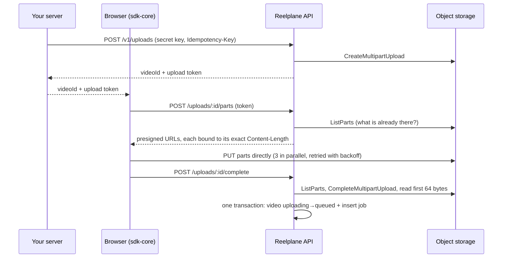

# Architecture and decisions

This document grows phase by phase. Each decision lists the trade-off it accepts.

## The upload path (Phase 3)



### Why direct-to-storage

Video bytes never pass through the API. Vercel functions have request-size and duration limits
that a 100 MB upload on a slow phone connection would exceed. Proxying uploads would also pay
for the same bytes twice. The API only signs URLs and keeps the bookkeeping.

### Why an upload token instead of a key in the browser

The developer's server creates the upload with its secret key and passes the browser an
`rp_ut_…` token. The token can only sign parts for, complete, or abort that one video, it
expires with the upload session (24 h), and only its hash is stored. A leaked token exposes one
in-progress upload, never the project.

### Size limits the client cannot lie about

A presigned `PUT` normally accepts any number of bytes, so a client could declare 1 MB and then
upload 5 GB. Each part URL is therefore signed with its exact `Content-Length`, and storage
itself rejects a part of any other size. The contract test checks this against the real S3
server. `complete` re-checks every part's size against storage's own `ListParts`.

### Resume: storage is the source of truth

Parts are 8 MiB. That is above S3's 5 MiB minimum and small enough that a dropped connection
loses little. On resume the client does not trust its own memory: it asks the API, which asks
storage via `ListParts`, and uploads only what is missing. This also works after a page reload
if the app persists `{videoId, token}`.

- **On part failure:** the client stops starting new parts, but lets parts already in flight
  finish before reporting the error. Real-storage tests showed why: otherwise a quick resume
  re-sent parts that were still mid-upload in the background.
- **Retry policy:** network errors, 408, 429 and 5xx are retried with exponential backoff and
  full jitter. A 403 (expired signature) is re-signed. Any other 4xx fails fast.

### Validation layers

1. **Request:** content type allow-list, size ≤ 100 MB, declared duration ≤ 60 s, strict schema.
2. **Storage:** the signed `Content-Length` on every part.
3. **Magic bytes on `complete`:** the file must start with an ISO-BMFF `ftyp` box or an EBML
   header that matches the declared type. HEIC/AVIF photos and M4A audio also use `ftyp`, so
   their brands are rejected explicitly; a renamed iPhone photo is refused. A rejected file is
   deleted and the video moves to `failed` with a reason.
4. **The worker's `ffprobe` (Phase 4):** the authoritative check for duration and streams.

### Idempotency

- **Create:** `POST /v1/uploads` honours an `Idempotency-Key` header (Stripe semantics). The
  key is claimed in a committed row before any work starts, so concurrent retries get
  "in progress" instead of a duplicate. Same key + same body replays the stored response
  (`Idempotent-Replayed: true`); same key + a different body is a 409. 4xx results are stored;
  5xx results release the key so a retry can succeed.
- **Complete:** idempotent by construction. The status flip and the job insert happen in one
  transaction under `SELECT … FOR UPDATE`. A replay sees `queued` and returns the video. The
  partial unique index on active jobs is a second guard. If a previous attempt assembled the
  object but crashed before the database write, the multipart upload is gone; `complete` then
  confirms the object exists with the declared size and carries on. Tests fire three concurrent
  completes and assert exactly one job.

## Data model and tenant isolation (Phase 2)

Schema: [`packages/db/migrations`](../packages/db/migrations). Main tables: `projects`,
`api_keys`, `videos`, `renditions`, `jobs`, `video_events`, `playback_events`, `likes`,
`webhook_endpoints`, `webhook_deliveries`, `idempotency_keys`.

### Isolation is enforced by Postgres, not by remembering `WHERE` clauses

Every table has row-level security (RLS). Application code never queries as the table owner:

| Caller                                   | How it connects                                   | What it can see                  |
| ---------------------------------------- | ------------------------------------------------- | -------------------------------- |
| API request with a key                   | `SET LOCAL ROLE reelplane_api` + `app.project_id` | that project's rows              |
| Dashboard user                           | `SET LOCAL ROLE reelplane_api` + `app.user_id`    | projects they own                |
| Transcoding worker                       | `SET LOCAL ROLE reelplane_worker`                 | all videos/jobs, **no** API keys |
| Migrations, `SECURITY DEFINER` functions | table owner                                       | everything                       |

`SET LOCAL` ends with the transaction, so a pooled connection cannot carry one tenant's context
into the next request (a test covers this). A query with a missing filter returns nothing from
other projects instead of leaking them. Tests try to read, update, delete and insert across
projects, and every attempt is refused by the database.

- **Why a private `reelplane` schema:** Supabase exposes `public` over its REST API (PostgREST).
  Our tables are in a schema it does not serve, so a misconfigured Supabase key cannot reach them.
- **Trade-off:** one extra `SET` round trip per transaction, and each new table must have its
  policy written. Both are cheap compared with a cross-tenant leak.

### API keys

Format: `rp_sk_…` (secret) or `rp_pk_…` (publishable). Each key is 32 random bytes in base62,
plus a 6-character CRC32 checksum.

- **The prefix** makes leaked keys easy for secret scanners to find, and tells the API the key
  kind without a lookup.
- **The checksum** rejects typos and garbage without touching the database.
- **Storage:** only `HMAC-SHA256(pepper, key)` and a 12-character display prefix are kept.
  Because keys carry 256 bits of entropy, a slow password hash (bcrypt, argon2) adds nothing:
  brute force is already impossible. A fast keyed hash gives an indexed lookup, and the pepper
  lives outside the database, so a stolen database alone can't be used to check guesses.
- **Rotation** issues a new key and gives the old one an `expires_at` grace period, so deployed
  clients can switch without downtime. **Revocation** takes effect immediately.
- **Publishable keys** only work from the project's allowed origins. Requests without an Origin
  header are allowed, because they can only read public feed data.
- **Secret keys** are refused whenever a browser Origin header is present, which catches a key
  that has leaked into frontend code.
- The key lookup runs before the project is known, so it is the one `SECURITY DEFINER`
  function. It writes `last_used_at` at most once a minute, keeping the hot feed path read-mostly.

### The audit trail is written by triggers

Every video status change and job state change is inserted into `video_events` by a trigger.
The same trigger rejects illegal transitions such as `uploading → ready`. No code path (API,
worker, cleanup job, manual SQL) can skip the timeline or corrupt the state machine. The API
role has no `UPDATE` or `DELETE` on `video_events`.

```
uploading ──► queued ──► processing ──► ready ──► deleted
    │           │  ▲          │
    │           │  └──retry───┘
    └──► failed ◄┴────────────┘     (failed ──► queued for a manual retry)
```

### Queue invariants live in the schema

- `jobs_one_active_per_video` is a partial unique index on (video, kind) for queued or running
  jobs. A retried "complete upload" request cannot create a second job.
- A `CHECK` constraint requires that a job is `running` exactly when it holds a lease.
- Partial indexes cover only runnable jobs (`state = 'queued'`) and expiring leases
  (`state = 'running'`), so the claim query stays fast however much history piles up.

### Migrations

Migrations are plain SQL files: the TypeScript API and the Go worker share one schema, with no
ORM in between. A small migrator applies each file in its own transaction, under a Postgres
advisory lock, and records a checksum. It refuses to run if an applied migration was edited,
which makes migrations append-only.
